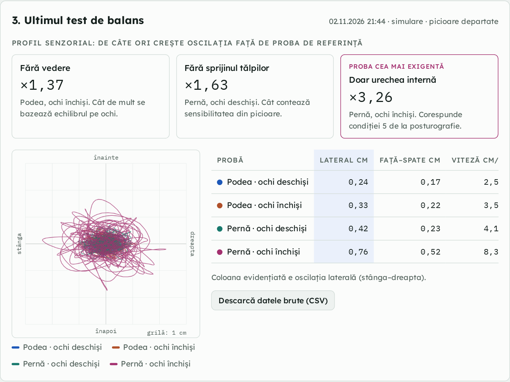
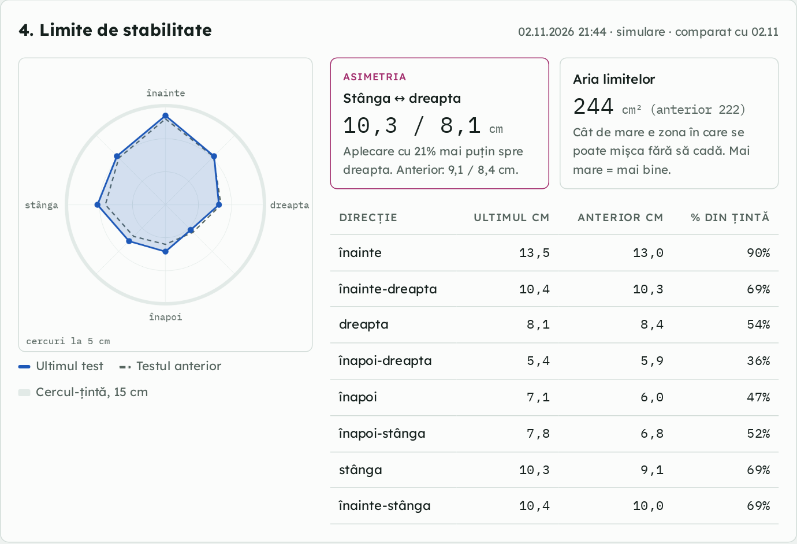
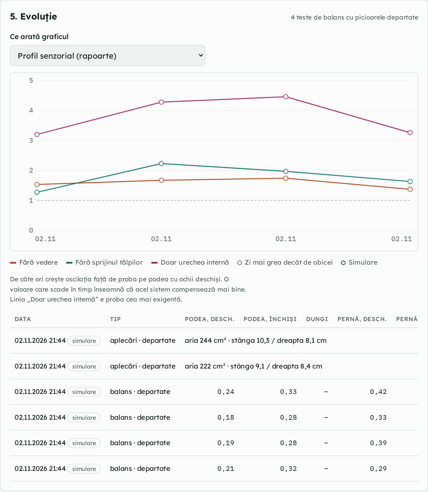

# Balance Journal XR

A home balance test that runs in the browser of a **Meta Quest 3**. The headset tracks the head while you stand still or lean, and the page turns that into the kind of numbers a clinical posturography report uses: sway velocity, lateral and front-back sway, the 95% sway ellipse, a sensory profile and limits of stability. Repeated two or three times a week, it shows whether balance is improving, stable or getting worse between visits to the doctor.

I built it for a member of my family, so the interface is in Romanian. **All results stay on the headset**: there is no server, no account and nothing is uploaded.

> Personal monitoring tool, not a medical device. Head movement follows body sway closely, but it is not the same measurement as a force platform in a clinic. The values are not comparable with clinical ones; what matters is the trend over time.

| Last balance test | Limits of stability | Evolution |
|---|---|---|
|  |  |  |

*Screenshots made with the built-in simulation mode, not real patient data.*

## How a test works

1. Open the page in the Quest Browser (it needs `https://`, which GitHub Pages provides) and fill in a short journal: unsteadiness and dizziness today (0–10), hours of sleep, a harder-than-usual day, headache, notes.
2. Choose the test and tick three safety checks: standing in a corner or close to a wall, a helper right next to you, no strong dizziness right now.
3. Press **Start**. The page opens a WebXR session, with passthrough when the headset supports it, so the real room stays visible. A floating panel shows each step. The trigger (or a pinch) starts a condition, three short beeps and a long one mark the start, two beeps the end. The grip button stops everything immediately.

**Sway test** (2–3 times a week): up to five conditions of 20 or 30 seconds, in a fixed order.

| Condition | What is taken away | What remains |
|---|---|---|
| Floor, eyes open | nothing: the reference | vision, feet, inner ear |
| Floor, eyes closed | vision | feet, inner ear |
| Floor, moving stripes (optional) | reliable vision: the stripes mislead it | feet, inner ear |
| Foam pad, eyes open | reliable information from the feet | vision, inner ear |
| Foam pad, eyes closed | vision and feet | mostly the inner ear, the home equivalent of condition 5 of clinical sensory organisation testing |

**Limits of stability** (once a week): a top-down map shows the head as a red dot. For each of eight directions: 3 seconds centred, then a slow lean from the ankles, without lifting the feet, towards a 15 cm target circle, then back.

**Safety stops:** a sway condition stops on its own if the head moves more than 20 cm from where it started, and a lean stops beyond 45 cm (a step). A stopped condition is recorded as such: that is information too.

## What it measures

The pose of the headset is read on every XR frame (72 Hz by default on Quest 3). For each condition:

- the first 2 seconds are skipped (settling), then a 5-sample moving average removes tracking jitter;
- positions are projected onto the direction the person was facing at the start, giving **front-back (AP)** and **lateral (ML)** sway;
- **path length** and **mean sway velocity** (cm/s), the most sensitive measure in posturography;
- **RMS and range** of AP and ML sway;
- the **95% confidence ellipse area**, π · 5.991 · √det(Σ), where Σ is the AP/ML covariance matrix (5.991 is the χ² value for two degrees of freedom at 95%);
- the **sensory profile**: the mean velocity of each condition divided by the reference condition. "×2.9 on foam with eyes closed" means sway is almost three times faster when only the inner ear is left. A ratio that falls over the weeks means that system is compensating better.

For limits of stability: the furthest excursion in each direction, the area of the eight-point polygon, and the left/right and front/back asymmetries, compared with the previous test.

The metric functions are pure and kept together at the top of the script (`METRICS-START` to `METRICS-END`), so they can be tested on their own.

## Where the data lives

- Every test is saved in the headset browser's **IndexedDB**, tied to the page's address. Opening the same address on another device shows an empty journal.
- **Notes from the clinical evaluation** (for example which direction or condition the doctor asked to watch) can be typed in once. They stay in the browser's local storage and appear next to the test instructions.
- **Export for the doctor:** a CSV with one row per condition (journal, metrics, ratios). **Raw data:** the head samples of the last test as CSV. **Backup:** a complete JSON file, which can be imported back.
- Clearing the browser data deletes the journal, so a monthly JSON backup on a computer is the safety net.
- The page itself loads three.js from jsDelivr and fonts from Google Fonts. Nothing is ever sent back.

## Try it without a headset

On a computer the **Simulation** button creates realistic random tests (marked as simulations, and deletable), so every chart and table can be seen without a Quest.

## Run it

It is a single static file, `index.html`, with no build step.

- **GitHub Pages:** Settings → Pages → Deploy from a branch → `main` / root. The page is then served at `https://<user>.github.io/balance-journal-xr/`.
- **Locally:** any static server works for the simulation (`python -m http.server`). WebXR on the headset needs `https://` (or `localhost`).

Keep the address once someone starts testing: the data belongs to it. Moving to a new address means Backup (JSON) on the old one and Import on the new one.

## How it was built

I wrote the specification, the test protocol and the safety rules; the code was written with Claude Code under my direction and checked in the browser with the simulation mode. The protocol follows clinical posturography (sensory organisation and limits of stability), adapted to what a headset can measure at home.

**Stack:** HTML, CSS and JavaScript in one file · WebXR (immersive-ar with passthrough, immersive-vr as a fallback) · three.js · Canvas 2D charts · IndexedDB · Web Audio for the beeps

## License

MIT
